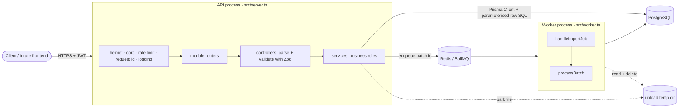
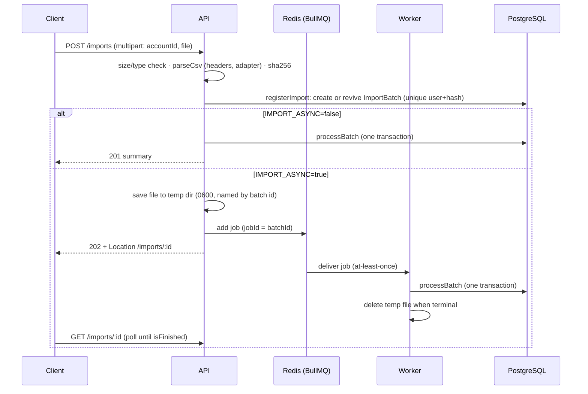

# Architecture

SpendSense is a **modular monolith**: one codebase, one database, two deployable processes (HTTP API and
import worker) built from the same image.

## Components

| Layer | Responsibility | Rule |
|---|---|---|
| `middleware/` | Cross-cutting HTTP concerns (auth, errors, request id) | No business logic |
| `modules/*/*.router.ts` | URL → handler mapping, per-route middleware | No logic |
| `modules/*/*.controller.ts` | Validate input with Zod, call one service function, shape the response | Thin; Express 5 forwards rejected promises, so no try/catch |
| `modules/*/*.service.ts` | Business rules, authorization (`userId` is always in the query), Prisma | The only place that talks to the database |
| `analytics/finance.ts` | Pure financial rules (no I/O, no clock) | Unit-tested with exact values |
| `shared/` | Errors, decimal/date/fingerprint helpers, validation primitives | No imports from modules |
| `infrastructure/` | Prisma singleton, pino logger, BullMQ queue | Swappable without touching domain code |

**Prisma vs raw SQL.** Prisma Client for CRUD and relational reads (accounts, categories, ledger listing, budgets,
goals, import history). Parameterised `$queryRaw` where PostgreSQL does something Prisma cannot: `FILTER` aggregates,
`generate_series` + `LAG` window functions, `AT TIME ZONE` bucketing, advisory locks, `SELECT … FOR UPDATE`,
`ON CONFLICT … WHERE`. Raw SQL is always a tagged template (values are bind parameters, never concatenated).

## Request flow

1. `request-id` accepts a safe client `X-Request-ID` or generates one; it is echoed in the response and in every log line.
2. Global per-IP rate limit (`/api`), stricter limiter on credential endpoints, per-user limiter on uploads.
3. `authenticate` verifies the JWT (HS256 pinned, issuer, audience, expiry, `sub` must be a UUID) and sets `req.user`.
4. The controller parses `params`/`query`/`body` with Zod (`400 VALIDATION_ERROR` with per-field details on failure).
5. The service runs queries scoped by `userId`. A row owned by someone else is indistinguishable from a missing one (`404`).
6. Errors reach `error-handler`, which maps Zod/AppError/Multer/Prisma errors to one envelope
   `{ error: { code, message, details[], requestId } }`. Unknown errors are `500` with a generic message in production;
   raw Prisma/SQL text never leaves the server.

## Import flow

### `registerImport` – upload idempotency

The unique `(user_id, file_hash)` index decides what a repeat upload means:

| Existing batch | Result |
|---|---|
| none | create `PENDING` |
| `COMPLETED` | `409 DUPLICATE_IMPORT` (points at the existing batch) |
| `PENDING`/`PROCESSING`, recently active | `409 IMPORT_IN_PROGRESS` |
| `FAILED`, `PARTIAL`, or stale `PENDING`/`PROCESSING` | **revive the same batch** (compare-and-set) and retry |

Two simultaneous uploads of one file race on the unique index; exactly one wins.

### `processBatch` – the atomicity model

**All writes for one file happen in a single database transaction**: import rows, transactions, back-links and batch
counters. A file is imported completely or not at all, so there is no "half-imported" state and a retry is simply
"run it again". Batch status changes outside that transaction (`PROCESSING`, `PARTIAL`, `FAILED`) are bookkeeping that
survives a rollback.

Inside the transaction:

1. `pg_advisory_xact_lock(hash(account_id))` – imports into the same account run one at a time, so the duplicate
   look-ups below cannot interleave with another import writing the same rows. Different accounts/users do not block each other.
2. `SELECT … FOR UPDATE` on the batch; if it is already `COMPLETED` (duplicate job delivery) return its summary.
3. Look up existing bank references and fingerprints in chunks (`IN` lists ≤ 5,000, far below the 32,767-bind-parameter limit).
4. Classify each row: `ACCEPTED`, `DUPLICATE`, `SKIPPED` (no amount), `REJECTED` (bad data). Apply merchant rules to accepted rows.
5. Bulk-insert all import rows, then transactions with `ON CONFLICT DO NOTHING`, then fill the circular
   `import_rows.transaction_id` link in one `UPDATE … FROM`.
6. **Verify** `inserted == accepted`. A shortfall (something wrote the same reference after our look-up) throws, rolls
   everything back, and the retry re-runs duplicate detection. Success is never reported unless the writes happened.
7. Update counters and set `COMPLETED`.

The unique `(account_id, source_tx_id)` index remains the last line of defence even if the advisory lock were bypassed.

## Background job design

* **Queue**: one BullMQ queue `statement-imports`; job id = batch id (enqueue is idempotent; finished jobs with that id are
  cleared first so a revived batch can run again). Job data is just `{ batchId, correlationId }` – no financial data in Redis.
* **File hand-off**: the API writes the CSV to `UPLOAD_TEMP_DIR/<batchId>.csv` (mode 0600). In Docker the API and worker share
  a volume. The worker deletes it as soon as the batch is terminal; an hourly sweeper deletes anything older than 24 h.
* **Retries**: `IMPORT_JOB_ATTEMPTS` (default 3) with exponential backoff (`IMPORT_JOB_BACKOFF_MS`, doubling).
  Between attempts the batch is `PARTIAL` (file kept); after the last attempt it is `FAILED` (file deleted, `errorMeta.retryable=true`).
* **Retryable vs permanent**: `PermanentImportError` (unparseable file, deleted account, missing upload) → BullMQ
  `UnrecoverableError`, no retries, batch `FAILED` with `retryable=false`. Everything else is retried.
* **At-least-once safety**: a redelivered or concurrently delivered job is harmless – `COMPLETED` batches are no-ops and the
  advisory lock + row lock serialise duplicates.
* **Crash recovery**: if a worker dies mid-job, BullMQ's stalled-job detection re-delivers it. Anything left `PENDING`/`PROCESSING`
  past `IMPORT_STALE_AFTER_MS` is treated as abandoned and may be revived by re-uploading the file.
* **Observability**: every log line has `batchId`, `userId`, `jobId`, `attempt` and the HTTP `correlationId`; completion logs
  duration and counts. Never rows, narrations or amounts.
* **Shutdown**: SIGTERM/SIGINT → `worker.close()` waits for active jobs (≤ 30 s), then closes Redis and Prisma.

## Reliability decisions at a glance

| Concern | Mechanism |
|---|---|
| Repeat upload of one file | unique `(user_id, file_hash)` + status-aware revive |
| Same bank row in two different files | `(account_id, source_tx_id)` unique index + fingerprint with occurrence ordinal |
| Concurrent imports into one account | advisory lock per account |
| Duplicate job delivery | idempotent `processBatch`, row lock, jobId = batchId |
| Partial failure | single transaction; `PARTIAL`/`FAILED` bookkeeping; revive on retry |
| Lost / swallowed writes | inserted-vs-expected check inside the transaction |
| Poison file | permanent-error classification, no retry storm |
| Cross-user references | composite foreign keys `(account_id, user_id)` |
| Graceful stop | HTTP drain + queue close + Prisma disconnect |
| Health | `/health` (liveness), `/health/ready` (database, plus Redis when async imports are on) |
