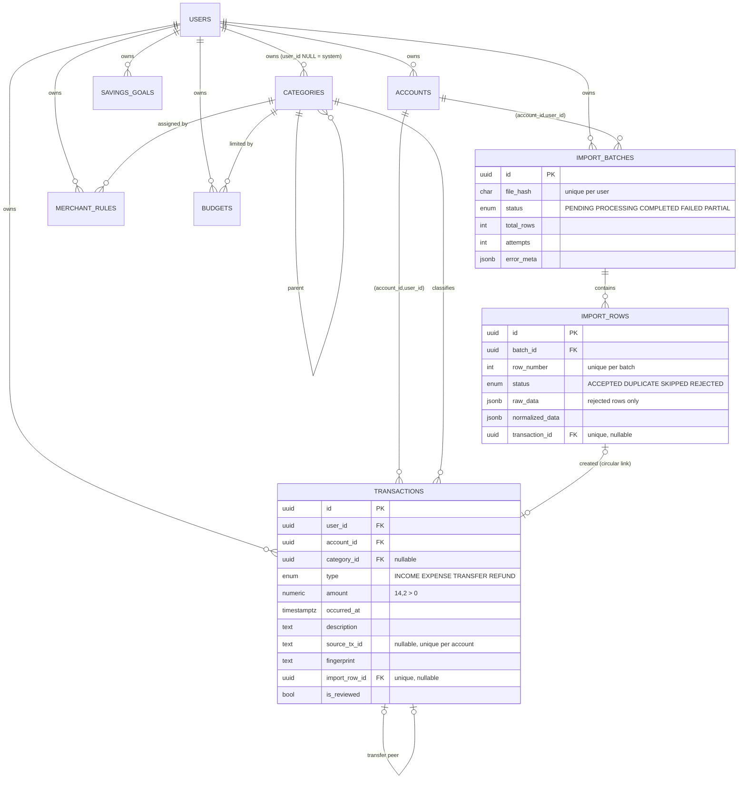

# Data model

Source of truth: [`prisma/schema.prisma`](../prisma/schema.prisma) plus the hand-written SQL in
`prisma/migrations/20261012120000_hardening_constraints/` for rules Prisma cannot express.

## ER diagram

## Tables

| Table | Purpose |
|---|---|
| `users` | Identity, bcrypt password hash, IANA `timezone` used for every month boundary. |
| `accounts` | A bank account, card, wallet or cash pocket. `opening_balance` = balance **before the first ledger transaction**; current balance is derived (opening + ledger). |
| `categories` | Two-level hierarchy. `user_id IS NULL` + `is_system` = built-in categories shared by everyone (immutable). |
| `merchant_rules` | Per-user auto-categorisation: case-insensitive substring `pattern` → category (+ canonical merchant name), ordered by `priority`. |
| `transactions` | **The ledger.** Amount is always positive; `type` carries direction. `occurred_at` (when it happened) is separate from `created_at`/`updated_at` (when we stored it). |
| `import_batches` | One row per uploaded file: hash, adapter, status, counters, attempts, `error_meta` (sanitised). History is kept after the file is deleted. |
| `import_rows` | One row per CSV data row: outcome, reason, normalised values, link to the created transaction. Explains every accepted, duplicate, skipped and rejected row. |
| `budgets` | Monthly limit per category. **No spend is stored** – utilisation is always derived from the ledger. |
| `savings_goals` | Target amount/date and a user-maintained `current_amount`. |

## Constraints

| Constraint | Why |
|---|---|
| UUID primary keys everywhere | Non-guessable ids; safe to expose. |
| `transactions (account_id, user_id) → accounts (id, user_id)` (composite FK, via `UNIQUE(id, user_id)`) | **The database refuses a transaction that points at someone else's account.** Same for `import_batches`. Tested directly with SQL-level inserts. |
| `UNIQUE (account_id, source_tx_id)` | Primary duplicate guard. NULLs are distinct, so reference-less rows are unaffected. |
| `UNIQUE (user_id, file_hash)` | A file can only have one batch per user. |
| `UNIQUE (batch_id, row_number)` | Row outcomes are idempotent. |
| `UNIQUE (user_id, name)` on accounts/categories; partial `UNIQUE (name) WHERE user_id IS NULL` on categories | Prevents duplicate names, including system categories (NULLs defeat a plain unique). Makes seeding idempotent. |
| `UNIQUE (user_id, category_id, period_month)` | One budget per category per month. |
| `CHECK amount > 0` (transactions, budgets, goals target); `current_amount >= 0` | Money is a positive magnitude. |
| `CHECK currency ~ '^[A-Z]{3}$'` | ISO-shaped codes only. |
| `CHECK period_month = date_trunc('month', period_month)` | Budgets are keyed by the first of the month. |
| `CHECK` import counters ≥ 0 and `accepted+duplicate+rejected+skipped ≤ total` | Counters cannot lie. |
| `CHECK transfer_peer_id <> id` | No self-pairing. |
| `ON DELETE CASCADE` only from `users`, `import_rows → batch` | Everything else is `RESTRICT`: history is never silently removed. Account/category deletion is mediated by the service (see below). |

Deleting things:

* **Transaction** – hard delete. Its import row is kept (`transaction_id = NULL`, reason "deleted by user") so the batch
  still reconciles; the batch stays `COMPLETED`, so re-uploading the same file cannot resurrect the row.
* **Category** – transactions become uncategorised, rules and budgets for it are removed, sub-categories are promoted.
* **Account** – refused with `409` if it has transactions or imports (deactivate instead).
* **User** – `DELETE /users/me` removes every owned row child-first in one transaction.

## Indexes

| Index | Query it serves |
|---|---|
| `transactions (user_id, occurred_at DESC)` | Ledger pages, month/range aggregates (dashboard, categories, trends), recurring detection |
| `transactions (user_id, type)` | Type filter |
| `transactions (user_id, category_id)` | Category filter / uncategorised inbox |
| `transactions (account_id, occurred_at DESC)` | Account-scoped ledger |
| `transactions (account_id, fingerprint)` | Import duplicate detection (index-only scan) |
| `transactions UNIQUE (account_id, source_tx_id)` | Import duplicate detection + the constraint itself |
| `import_batches (user_id, created_at DESC)` | Import history |
| `import_rows (batch_id, status)` | Row inspection by outcome |
| `budgets (user_id, period_month)` | Month view |

Measured plans and the indexes we *rejected* are in [performance.md](performance.md).

## Prisma-specific decisions

* **Money** – `Decimal @db.Decimal(14,2)`; arithmetic uses `Prisma.Decimal` (decimal.js). Serialised as 2-dp strings. No JS floats.
* **Composite relation** – `Transaction.account` uses `fields: [accountId, userId]`, which is how the ownership FK is modelled.
* **Circular link** – `transactions.import_row_id` ↔ `import_rows.transaction_id` are both nullable and unique; rows are inserted
  first, then transactions, then the back-link is set with one `UPDATE … FROM` (Prisma cannot insert both sides of a cycle at once).
* **`createMany({ skipDuplicates })`** – compiles to `ON CONFLICT DO NOTHING`; the pipeline compares the inserted count to the expected one.
* **Raw SQL** – only parameterised tagged templates; each raw query is covered by an integration test with exact expected values.
* **Client generation** – `postinstall: prisma generate`; the Docker image generates explicitly.
